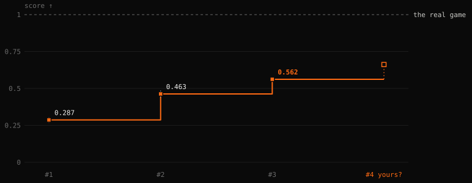
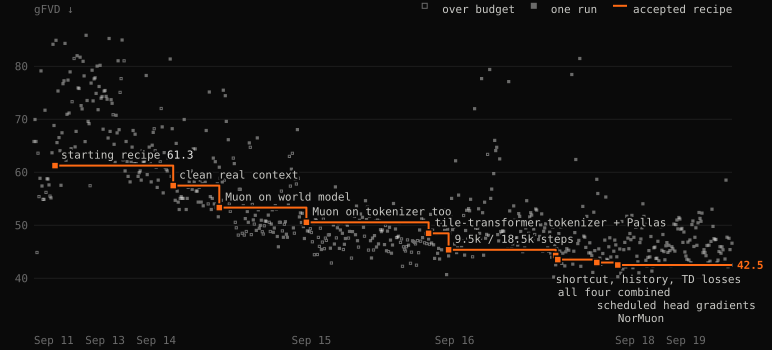
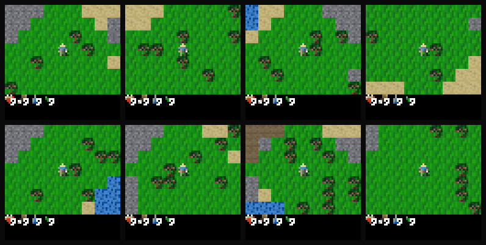

### Train a world model in under 10 minutes for $0.1 of compute, and play it!

**[Play it in your browser](https://maharishiva.github.io/tinywmcraft/#play)** ·
[Autoresearch Benchmark](#autoresearch-benchmark) ·
[Diamond Speedrun](#diamond-speedrun)

[](https://maharishiva.github.io/tinywmcraft/#play)

tinywmcraft is a 14M-parameter world model of [Craftax](https://github.com/MichaelTMatthews/Craftax), a 2D Minecraft, learned from scratch to predict the next frame from past frames and actions alone.
No game engine runs behind the [browser player](https://maharishiva.github.io/tinywmcraft/#play): every frame is generated by the network on your GPU, one action at a time.

### Play it

Open the [player](https://maharishiva.github.io/tinywmcraft/#play) (needs WebGPU, desktop or phone). WASD to move, space to act, the placements and crafts on buttons.
Walk around, craft, fight, sleep through the night, and see what the model gets wrong: it learned the game from pixels, so it has its own ideas about the rules.

## Autoresearch Benchmark

tinywmcraft is first and foremost an autoresearch benchmark: train your own world model in under 10 minutes on one A100 and beat the best score.
Paste this into Codex, Claude Code or any coding agent:

```text
/goal Clone https://github.com/Maharishiva/tinywmcraft, read program.md,
get a GPU (a Google Colab A100 works: uv tool install google-colab-cli),
beat the best world model under the rules on all three seeds,
and only then open a pull request.
```



| # | change | score ↑ | gFVD ↓ | logic ↑ | memory ↑ | code |
|---|---|---:|---:|---:|---:|---|
| 1 | [train_tiny.py](train_tiny.py): the whole model in 178 lines, no custom kernels | 0.287 ± 0.019 | 67.2 | 0.03 | 0.056 | [23e6515](https://github.com/Maharishiva/tinywmcraft/blob/23e6515/train_tiny.py) |
| 2 | tile transformer tokenizer, fused Pallas kernels, hard-window mining, symlog reward head | 0.463 ± 0.023 | 44.3 | 0.55 | 0.087 | [80b1c34](https://github.com/Maharishiva/tinywmcraft/blob/80b1c34/train.py) |
| 3 | [train.py](train.py): clean/masked/noised tokenizer, flow matching + shortcut loss, Muon, two fused kernels, 1/8 game-start windows | 0.562 ± 0.017 | 27.2 | 0.69 | 0.087 | [8538aa5](https://github.com/Maharishiva/tinywmcraft/blob/8538aa5/train.py) |

Mean ± sample SD over seeds 0, 1 and 2 on one Colab A100-SXM4-40GB. Beat iteration 3 and yours is iteration 4: the crown goes next to your GitHub login and the browser player switches to your model. Every metric: [evaluation](#evaluation) and the [live leaderboard](https://maharishiva.github.io/tinywmcraft/benchmark.html).



Our own autoresearch loop while the benchmark was being built: 698 runs in 8 days, ranked on **gFVD** alone (how real the imagined play looks, lower is better), on development data and an earlier eval. Now it is your agent's turn, on the full score: [program.md](program.md).

## How it works


**13.9M parameters** (5.2M tokenizer, 8.6M world model), trained on [500k transitions](https://huggingface.co/datasets/maharishiva/tinywmcraft-v3) of Craftax-Classic pixels and actions ([dataset](#dataset)), with no game state, tile labels or pretrained features.
**One training run is under 10 minutes on one A100 (~$0.10); eval about 2.5 minutes.**

| file                           | what it is                                                                                                                   |
| ------------------------------ | ---------------------------------------------------------------------------------------------------------------------------- |
| [train.py](train.py)           | iteration 3, the one to beat: MSE tokenizer and diffusion forcing world model with reward and termination heads (~350 lines) |
| [kernels.py](kernels.py)       | two fused Pallas kernels for NVIDIA GPUs (attention, and a gated residual add with the next norm) for speed ⚡️               |
| [eval.py](eval.py)             | the frozen benchmark (clips built by [make_eval.py](make_eval.py) from [collect/](collect/))                                 |
| [play_wm.py](play_wm.py)       | play inside a trained model with your keyboard                                                                               |
| [train_tiny.py](train_tiny.py) | iteration 1: the whole model in 178 lines, no custom kernels, for learning                                                   |
| [program.md](program.md)       | benchmark rules, model interface and how to submit                                                                           |
| [SPEEDRUN.md](SPEEDRUN.md)     | the Diamond Speedrun rules and the glitch thread                                                                             |

- **Tokenizer.** A 63×63 frame becomes a 4×4×32 latent: the 81 tiles of 7×7 pixels are tokens for six transformer blocks, then a stride-2 conv and four residual conv blocks; the decoder mirrors it. A third of each batch is clean, a third has half its tiles grey and a third is noised; the target is always the clean frame. Without the masked and noised thirds, game logic falls apart.
- **World model.** A six-block, width-256 transformer alternates spatial attention over the 16 latent tokens with causal attention across 32 frames. The action, each frame's noise level and the sampler's step size condition adaLN-zero blocks; flow matching predicts the clean latent, and eight Euler steps generate each frame.
- **Losses.** Tokenizer: MSE to the clean frame. World model: flow matching with diffusion forcing (each frame its own noise level) plus a shortcut loss; a two-hot reward head and a done head.

## Quickstart

Play the best model (CPU works):

```bash
git clone https://github.com/Maharishiva/tinywmcraft && cd tinywmcraft
uv venv --python 3.11 && source .venv/bin/activate
uv pip install -r pyproject.toml --extra play
curl -L --fail --create-dirs -o runs/best/model.npz https://huggingface.co/maharishiva/tinywmcraft-v3/resolve/main/iteration3/seed2/model.npz
python play_wm.py --model runs/best/model.npz
```

Train and score your own on an NVIDIA GPU:

```bash
uv pip install -r pyproject.toml --extra cuda
HF_DATASET=https://huggingface.co/datasets/maharishiva/tinywmcraft-v3
curl -L --fail --create-dirs -o data/train.npz $HF_DATASET/resolve/main/train.npz
curl -L --fail -o data/eval.npz $HF_DATASET/resolve/main/eval.npz
python train.py --data data/train.npz --out runs/base/model.npz --seed 0   # under 600 s on one A100, compilation included
python eval.py  --model runs/base/model.npz --tag base --gif               # about 2.5 minutes, appends to ledger.jsonl
```

## Rules

- **Data:** `train.npz` only (500k transitions). No external data or pretrained weights.
- **Compute:** ≤ 600 s training and ≤ 300 s eval (`eval_s`: import, load, compile, generate; iteration 3 takes about 150 s) on one A100 40GB, no persistent compilation cache.
- **Evaluator:** `eval.py` stays byte-identical; causal generation (one frame per action, no future actions).
- **Seeds & gates:** report seeds 0, 1 and 2. Mean score must beat the best by a noise-aware margin, with reward AP ≥ 95% of iteration 1 and done AP ≥ 0.15. Ranked on a private test set built the same way. Full details: [program.md](program.md).

## Dataset

`train.npz` holds 500k transitions (250 streams of 2000 steps) of 63×63 frames, actions, rewards and episode ends from four RL agents ([collect/](collect/)).

On Hugging Face: [`train.npz`](https://huggingface.co/datasets/maharishiva/tinywmcraft-v3/blob/main/train.npz) (1.4 GB), [`eval.npz`](https://huggingface.co/datasets/maharishiva/tinywmcraft-v3/blob/main/eval.npz) (0.4 GB), and the [checkpoints](https://huggingface.co/maharishiva/tinywmcraft-v3) of every iteration.

## Evaluation

The frozen evaluator ([eval.py](eval.py), clips built by [make_eval.py](make_eval.py)) primes the model with eight real frames of held-out play, then generates one frame per action. Submissions are ranked on a private test set built the same way.

- **Score ↑** a north star metric to optimize: 0.4 gFVD + 0.2 logic + 0.2 memory + 0.1 reward + 0.1 done, each normalized to [0, 1]
- **Play (gFVD ↓):** Fréchet distance (× 10^4) in a fixed random CNN over 2048 clips of 64 actions
- **Logic ↑:** 8 scripted actions across 7 families (chop, mine, drink, eat, place, craft, sleep), with and without required tools, stations or ingredients. Passes if inventory, food, drink, target cell and sleep tint match the real game on all 8 frames; scored as true-positive plus true-negative pass rate minus 1.
- **Memory ↑:** out-and-back walks (48 and 144 actions) across gap buckets from 4–7 to 64+ frames, half **recall** (context cells returning to view vs. random context blocks) and half **self-consistency** (model-generated cells leaving and returning vs. other generated cells).
- **reward AP ↑ and done AP ↑:** average precision of the reward and termination heads on real transitions.

## Diamond Speedrun

Get a diamond inside the world model: in the [browser player](https://maharishiva.github.io/tinywmcraft/#play), not in the real game.
The fastest runs go up on the [site](https://maharishiva.github.io/tinywmcraft/) with your handle.

**What counts:** a diamond in the inventory that [iteration 3](https://maharishiva.github.io/tinywmcraft/?model=iteration3#play) draws, the model the site plays; that link keeps playing it when a newer model takes over the site. The player reads the inventory itself: when a diamond shows there on two frames in a row, it says DIAMOND! and marks the clip with the step it came on. The fewest steps win.

**How to submit:** press **save clip**, then post the clip in the [Diamond Speedrun discussion](https://github.com/Maharishiva/tinywmcraft/discussions/9), and on X with a link to this repo if you like, tagging [@rldoeswork](https://x.com/rldoeswork) (**share** writes the caption for you). The clip shows the seed and the action under every frame, so the maintainer can watch it and replay the run. Edited videos, other model files and the real game do not count. The full rules: [SPEEDRUN.md](SPEEDRUN.md).

**Also find the best glitch.** The model hallucinates in funny ways: post your weirdest clip in the [glitch discussion](https://github.com/Maharishiva/tinywmcraft/discussions/10). Just kudos for being a world breaker. Every diamond clip and the best glitches go up on the [site](https://maharishiva.github.io/tinywmcraft/) with your handle!



Eight worlds imagined from noise, each played inside the model by the diamond-trained RL agent that collected most of the data, 100 actions each; the two at the bottom right fall into night and sleep. Played on for 450 actions, 44 of 256 such worlds get a diamond.

## References

[Craftax](https://arxiv.org/abs/2402.16801) ·
[Flow Matching](https://arxiv.org/abs/2210.02747) ·
[Diffusion Forcing](https://arxiv.org/abs/2407.01392) ·
[DiT](https://arxiv.org/abs/2212.09748) ·
[Dreamer 4](https://arxiv.org/abs/2509.24527) ·
[Shortcut Models](https://arxiv.org/abs/2410.12557) ·
[Muon](https://kellerjordan.github.io/posts/muon/) ·
[FVD](https://arxiv.org/abs/1812.01717)

MIT license. Game sprites in the browser player are from Craftax (MIT).
