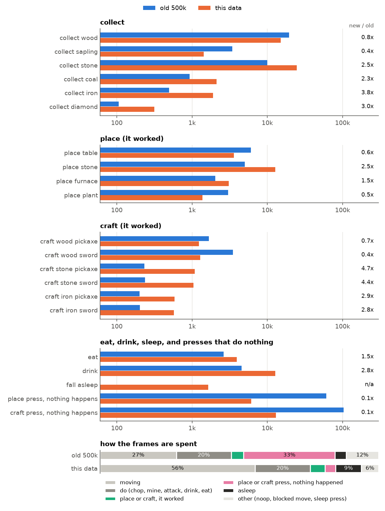
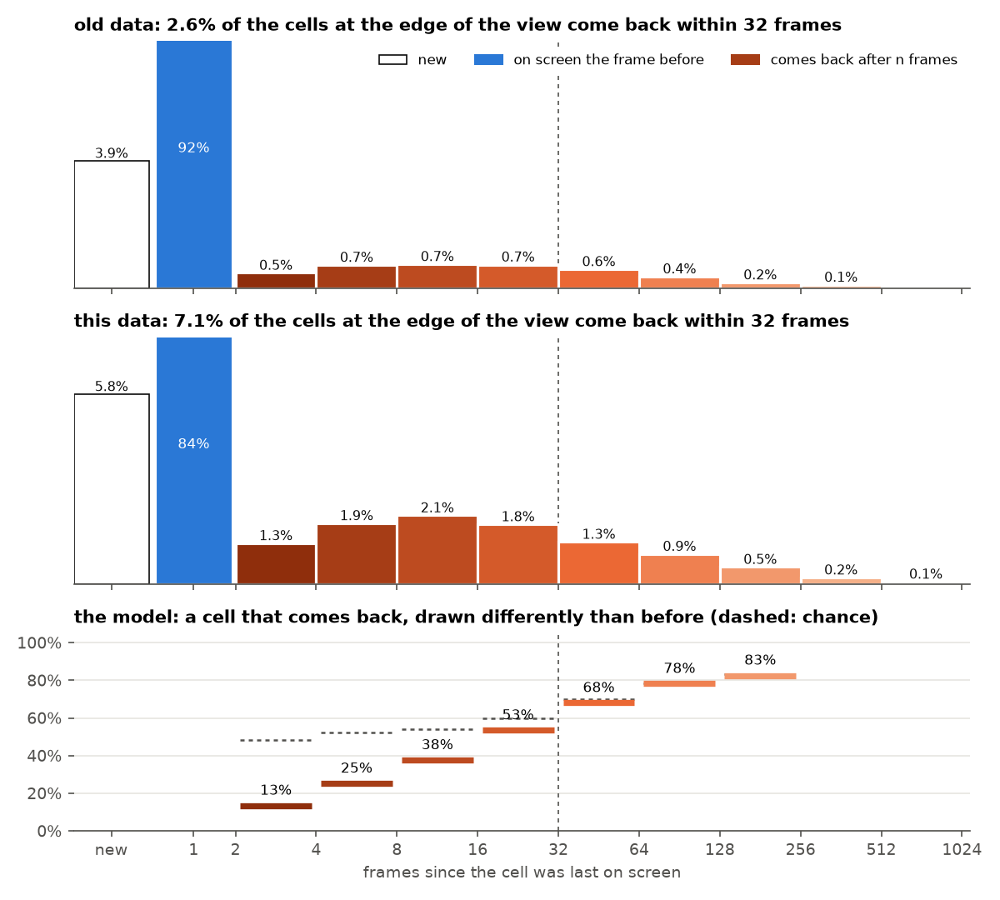

<p align="center">
  <picture>
    <source media="(prefers-color-scheme: dark)" srcset="docs/assets/logo-dark.png">
    
  </picture>
</p>

<h3 align="center">Train a world model in under 10 minutes for $0.1 of compute, and play it!</h3>

<div align="center">

[**Play it in your browser**](https://maharishiva.github.io/tinywmcraft/#play) ·
[Benchmark](#benchmark) ·
[How to beat it](program.md) ·
[Challenge](CHALLENGE.md) ·
[Checkpoints](https://huggingface.co/maharishiva/tinywmcraft-v3) ·
[Dataset][HF_DATASET]

</div>

<p align="center">
  <a href="https://maharishiva.github.io/tinywmcraft/#play"></a>
</p>

<p align="center"><sub>One held-out episode. Eight real frames prime the model, then it imagines 32 frames from the recorded actions alone.
Real game left, world model right, the action below.</sub></p>

tinywmcraft is a 14M-parameter world model of [Craftax](https://github.com/MichaelTMatthews/Craftax), a 2D Minecraft, learned from scratch to predict the next frame from past frames and actions alone.
No game engine runs behind the [browser player](https://maharishiva.github.io/tinywmcraft/#play): every frame is generated by the network on your GPU, one action at a time, and every world starts from a first frame the model imagines from noise.

### Play it

Open the [player](https://maharishiva.github.io/tinywmcraft/#play) in Chrome, Edge or Safari 26+ (it needs WebGPU), on a phone too. WASD to move, space to act, the placements and crafts on buttons; a first visit walks you through the first tree and table.
Walk around, craft, fight, sleep through the night, and see what the model gets wrong: it learned the game from pixels, so it has its own ideas about the rules.

**Challenge, no code and no GPU: get a diamond inside the world model.** With the diamond in the inventory the model draws, press save clip and post the clip on X with a link to this repo, or open an issue here.
The first verified diamond clip wins a paper copy of Sutton & Barto's *Reinforcement Learning*.
**Or find the best glitch:** the model hallucinates in funny ways, so post your weirdest clip. Every diamond clip and the best glitches go up on the site with your handle. What counts and how clips are checked: [CHALLENGE.md](CHALLENGE.md).

### Beat it

tinywmcraft is also an autoresearch benchmark: train your own in under 10 minutes on one A100 and beat the best score.
You or your coding agent push the score up, then you play the model you made: beat iteration 3 and the browser player switches to your model.
Paste this into Codex, Claude Code or any coding agent:

```text
/goal Clone https://github.com/Maharishiva/tinywmcraft, read program.md, get a GPU (a Google Colab A100 works: uv tool install google-colab-cli), beat the best world model under the rules on all three seeds, and only then open a pull request.
```

<p align="center">
  
</p>

**13.9M parameters** (5.2M tokenizer, 8.6M world model), trained on [500k transitions][HF_DATASET] of Craftax-Classic pixels and actions,
played by RL agents that reach diamonds, die in every way the game allows, break their own crafting habits and walk back to places they saw before ([dataset](#dataset)).
No game state, tile labels or pretrained features enter the model.
**One training run is under 10 minutes on one A100, about $0.1 of compute; the eval takes under 3 minutes more.**

| file | what it is |
|---|---|
| [train.py](train.py) | iteration 3, the one to beat: tokenizer and flow-matching world model with reward and termination heads, about 350 lines |
| [kernels.py](kernels.py) | two fused Pallas kernels for NVIDIA GPUs (attention, and a gated residual add with the next norm); plain XLA elsewhere |
| [eval.py](eval.py) | the frozen benchmark |
| [make_eval.py](make_eval.py) | builds the eval clips from held-out play |
| [collect/](collect/) | the data collector: agents, the behaviour schedule, return trips and the packer |
| [play_wm.py](play_wm.py) | play inside a trained model with your keyboard |
| [train_tiny.py](train_tiny.py) | iteration 1, the whole model on one page: about 250 lines, no custom kernels |
| [program.md](program.md) | rules, the model interface, and how to submit, for people and for coding agents |
| [CHALLENGE.md](CHALLENGE.md) | the no-code challenge: what counts as a diamond, how to submit a clip, how it is checked |

## Benchmark

| # | change | score ↑ | gFVD ↓ | logic ↑ | memory ↑ | reward AP ↑ | done AP ↑ | train s | code | checkpoints |
|---|---|---:|---:|---:|---:|---:|---:|---:|---|---|
| 1 | [train_tiny.py](train_tiny.py): the whole model in one file, no custom kernels | 0.270 ± 0.031 | 65.9 | 0.01 | 0.063 | 0.928 | 0.248 | 559 | [89e3539](https://github.com/Maharishiva/tinywmcraft/blob/89e3539/train_tiny.py) | [iteration1](https://huggingface.co/maharishiva/tinywmcraft-v3/tree/main/iteration1) |
| 2 | tile transformer tokenizer, fused Pallas kernels, hard-window mining, symlog reward head | 0.443 ± 0.013 | 44.3 | 0.55 | 0.087 | 0.934 | 0.247 | 582 | [80b1c34](https://github.com/Maharishiva/tinywmcraft/blob/80b1c34/train.py) | [iteration2](https://huggingface.co/maharishiva/tinywmcraft-v3/tree/main/iteration2) |
| 3 | [train.py](train.py): a tokenizer trained on clean, masked and noised frames, flow matching with a shortcut loss, Muon, two fused kernels, half the windows start a game | 0.471 ± 0.022 | 28.6 | 0.53 | 0.089 | 0.900 | 0.204 | 569 | [07dfac3](https://github.com/Maharishiva/tinywmcraft/blob/07dfac3/train.py) | [iteration3](https://huggingface.co/maharishiva/tinywmcraft-v3/tree/main/iteration3) |

Three snapshots of our own research so far, each trained on the benchmark data. Score: the north star, 0 for a trivial model and 1 for the real game ([evaluation](#evaluation)); gFVD shown times 10^4.
Mean ± sample SD over training seeds 0, 1 and 2, each trained cold on one Colab A100-SXM4-40GB and scored by `eval.py` on the public eval clips; train s is the slowest seed.
Beat iteration 3 and yours is iteration 4: the crown goes next to your GitHub login, and the browser player switches to your model. How: [program.md](program.md). The same table on the site, with the score over time: [benchmark](https://maharishiva.github.io/tinywmcraft/benchmark.html).

## Quickstart

Play the best model. No dataset or GPU needed; a Mac CPU works:

```bash
git clone https://github.com/Maharishiva/tinywmcraft && cd tinywmcraft
uv venv --python 3.11 && source .venv/bin/activate
uv pip install -r pyproject.toml --extra play
curl -L --fail --create-dirs -o runs/best/model.npz https://huggingface.co/maharishiva/tinywmcraft-v3/resolve/main/iteration3/seed0/model.npz
python play_wm.py --model runs/best/model.npz
```

Train and score your own on an NVIDIA GPU:

```bash
uv pip install -r pyproject.toml --extra cuda
HF_DATASET=https://huggingface.co/datasets/maharishiva/tinywmcraft-v3
curl -L --fail --create-dirs -o data/train.npz $HF_DATASET/resolve/main/train.npz
curl -L --fail -o data/eval.npz $HF_DATASET/resolve/main/eval.npz
python train.py --data data/train.npz --out runs/base/model.npz --seed 0   # under 600 s on one A100, compilation included
python eval.py  --model runs/base/model.npz --tag base --gif               # about 3 minutes, appends to ledger.jsonl
```

## Rules

- **Data:** train only on [`train.npz`][HF_DATASET], at most 500k transitions. No other data, no pretrained weights.
- **Compute:** at most 600 s per training run on one A100 40GB, everything included, with no persistent compilation cache.
- **Evaluator:** `eval.py` stays byte-identical and its timed part (`eval_s`: importing and loading your model, compiling, generating) takes at most 300 s on the same GPU. Any model, any sampler and any context length, as long as it generates one frame per action without seeing future actions.
- **Seeds:** report training seeds 0, 1 and 2.
- **Gates:** the mean score beats the best by a noise-aware margin; the three-seed means of reward AP and done AP stay at or above fixed floors (95% of iteration 1, and 0.15). Ranked on the score alone, measured on a private test set built the same way from other worlds.

Details, the model interface and how to submit: [program.md](program.md).

## How it works

- **Tokenizer.** A 63×63 frame becomes a 4×4×32 latent: the 81 tiles of 7×7 pixels are tokens for six transformer blocks, then a stride-2 conv and four residual conv blocks; the decoder mirrors it. A third of each batch is clean, a third has half its tiles grey and a third is noised; the target is always the clean frame. Without the masked and noised thirds, game logic falls apart.
- **World model.** A six-block, width-256 transformer alternates spatial attention over the 16 latent tokens with causal attention across 32 frames. The action, each frame's noise level and the sampler's step size condition adaLN-zero blocks; flow matching predicts the clean latent, and eight Euler steps generate each frame.
- **Losses.** Next to flow matching, a shortcut loss teaches one step to land where two half steps would. Half of the training windows start at a real game start, so the model can also imagine a first frame from nothing; the browser player starts every world that way.
- **Heads.** A reward head (two-hot over 255 symlog bins) and a termination head read each frame's mean token, so the model predicts rewards and episode ends along with frames. Their gradient into the trunk drops to a tenth in the second half of training.
- **Optimizer.** Muon on every matrix and conv kernel (five Polar Express steps in bf16, same-shape matrices as one stack); AdamW on the action embedding, biases and norms; warmup, constant, then linear decay over the last 20% of steps. 9k tokenizer steps, then 19k world-model steps.
- **Kernels.** At width 256 the step is bound by memory traffic. Two Pallas kernels read the activations in place: attention over a frame's tokens or causally over the frames, and a gated residual add fused with the next modulated RMS norm. They make a world-model step 2x faster than plain XLA.
- **Sampling.** Spatial attention stays within a frame and temporal attention is causal, so the past frames' keys and values are computed once per new frame and each Euler step runs only the new frame. The browser player does the same: about 7 GFLOP per action on WebGPU.

**Tried and dropped.** Iteration 3 is the short version of a longer recipe. These parts cost code or time and did not move the score over three seeds, so they went: the tokenizer seeing the frame before, training on the model's own generated past, a loss on how latents change from frame to frame, NorMuon's per-neuron step sizes, a separate optimizer for the heads, oversampling the hardest windows, and most of the custom kernels. The time they took now goes to more world-model steps. 534 lines instead of 1113, the same score.

## Dataset

[`train.npz`][HF_DATASET] holds 500k transitions (250 streams of 2000 steps) of 63×63 frames, actions, rewards, episode ends, and the pieces that begin a real game.
A world model learns the habits of the agents that made its data as if they were rules of the game: if the sword always comes first, it makes a sword when asked for an iron pickaxe; if iron tools always follow place furnace, it makes them whenever the last action was place furnace.
So four RL agents play (a pixel PPO agent fine-tuned for diamonds drives most episodes), and a behaviour schedule makes their play more varied:

- **Counterexamples to shortcuts:** iron pickaxes made with no sword, crafts at an old furnace, presses that fail (no table, no furnace, a missing ingredient, the wrong pickaxe), repeat placements. The iron sword comes before the iron pickaxe in 67% of the pieces that make both, not in all of them.
- **Deaths of every kind:** 802 in all, by zombies, skeletons, lava (119), thirst, starvation and exhaustion, some as whole episodes.
- **Diamonds:** 316, 281 of them the first of an episode, some as a whole game from the start to the diamond.
- **Return trips** for memory: about every third step of free play the agent peeks a few tiles away and back, or walks a loop of 4 to 63 tiles, so places leave the view and come back.
- **Work in daylight:** chopping, mining, placing and crafting that work count as events too, mostly by day, so the trips do not push the work into the night.

Pieces are cut only at quiet moments, never on a reward or an inventory change, and chosen so that events, not frames, are balanced; the cells that come back into view count as events too. The code is in [collect/](collect/).

<p align="center">
  
</p>

<p align="center"><sub>Game events per 500k transitions, on a log scale: what the agents collect, place and craft when it works, and the presses that do nothing.
The bar at the bottom is how the frames are spent: moving 56%; chopping, mining, attacking, drinking and eating 20%; placing or crafting that works 5%; presses that do nothing 4%; asleep 9%; other 6%.</sub></p>

<p align="center">
  
</p>

<p align="center"><sub>Top: the cells that enter the view at its edge, by how many frames ago they were last on screen. White: new, never seen before (5.8%); blue: on screen the frame before (84%); orange: seen, hidden and back, by gap. 7.1% come back within 32 frames, so memory can be learned and measured.
Bottom: how often iteration 3 draws a returning cell differently than it drew it before, by gap (dashed: chance). 13% after 2-3 frames, 53% at 16-31 frames, and at chance from 32 frames on.</sub></p>

## Evaluation

The frozen evaluator scores clips of held-out play from other worlds, built by [make_eval.py](make_eval.py). Every clip starts with eight real frames; then the model generates one frame per recorded action.
Probes read the generated frames with the game's own textures: HUD digits, map cells, the sleep tint.

- **Play:** 2048 clips of 64 actions, 512 of them with a rare event early on (a diamond, an iron tool, eating a plant, a death). **gFVD ↓** is the Fréchet distance between real and generated frames in a fixed random CNN's feature space, times 10^4 (not comparable to I3D FVD).
- **Logic ↑:** eight scripted actions from a real state next to something to use, in seven families: chop, mine, drink, eat, place, craft, sleep, with and without the right tool, table, furnace or ingredients, crafts in any order. A case passes if the inventory, food and drink, the target cell and the sleep tint match the real game on all eight frames. Per family, the pass rate where the game changed something plus the pass rate where it did not, minus 1.
- **Memory ↑:** walks out and back (48 and 144 actions), half recall and half self-consistency, each in gap buckets from 4-7 to 64+ frames. Recall: map cells seen in the context come back into view; the share drawn as the real block, scored as a gain over drawing a random block of the last context frame. Self-consistency: cells the model first drew itself leave the view and come back on another screen tile; the share drawn the same way as before, scored as a gain over the earlier drawing of another such cell in the same clip.
- **Score ↑** (the headline): 0.25 gFVD + 0.25 logic + 0.25 memory + 0.125 reward + 0.125 done, each part clipped to [0, 1]. gFVD on a log scale from copying the last frame (170, scores 0) to the real game replayed with fresh randomness (14, scores 1); logic; memory; reward and done as the AP's gain over its base rate, (AP - base) / (1 - base). Copying the last frame scores 0. Looping the eight context frames gets 0.14, all from gFVD, without learning anything, so the rules ask for a learned model ([program.md](program.md)). The weighted geometric mean of the same parts is logged as `score_geometric` for comparison; the ranking uses the score.
- **reward AP ↑ and done AP ↑:** average precision of the reward and episode-end heads on real transitions; the base rates are logged next to them.

A private test set, built the same way from other worlds, judges submissions; the public `eval.npz` is for development.

<p align="center">
  
</p>

<p align="center"><sub>A held-out clip: eight real frames prime the model, then it generates one frame per recorded action.
Ground truth left, world model right, same actions.</sub></p>

## References

[Craftax](https://arxiv.org/abs/2402.16801) ·
[Flow Matching](https://arxiv.org/abs/2210.02747) ·
[Diffusion Forcing](https://arxiv.org/abs/2407.01392) ·
[DiT](https://arxiv.org/abs/2212.09748) ·
[Dreamer 4](https://arxiv.org/abs/2509.24527) ·
[Shortcut Models](https://arxiv.org/abs/2410.12557) ·
[Muon](https://kellerjordan.github.io/posts/muon/) ·
[FVD](https://arxiv.org/abs/1812.01717)

MIT license. Game sprites in the browser player are from Craftax (MIT).

[HF_DATASET]: https://huggingface.co/datasets/maharishiva/tinywmcraft-v3
