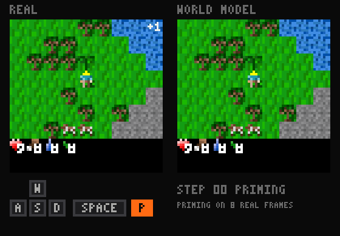
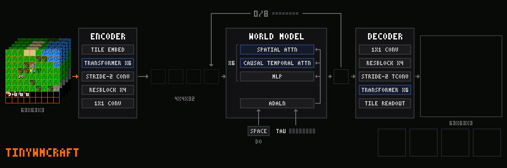
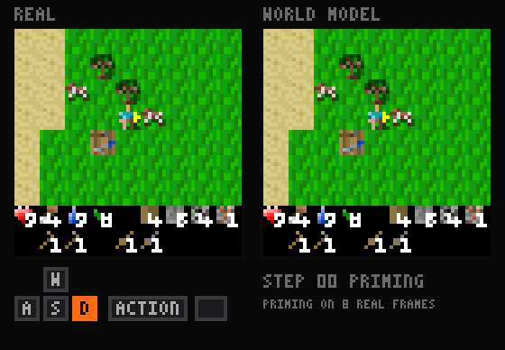

<p align="center">
  <picture>
    <source media="(prefers-color-scheme: dark)" srcset="docs/assets/logo-dark.png">
    
  </picture>
</p>

<h3 align="center">Train a world model in under 10 minutes for $0.1 of compute, and play it!</h3>

<div align="center">

[**Play it in your browser**](https://maharishiva.github.io/tinywmcraft/) ·
[Benchmark](#benchmark) ·
[How to beat it](program.md) ·
[Checkpoints](https://huggingface.co/maharishiva/tinywmcraft) ·
[Dataset][HF_DATASET]

</div>

<p align="center">
  
</p>

<p align="center"><sub>One held-out episode. Eight real frames prime the model, then it imagines 32 frames from the recorded keys alone.
Real game left, world model right, pressed key below.</sub></p>

Point your agents at this autoresearch benchmark: train your own tiny world model on Craftax in under 10 minutes on one A100 and beat our best score!

Every frame in the [browser player](https://maharishiva.github.io/tinywmcraft/) is generated by a neural network on your GPU, one keypress at a time.
tinywmcraft is a 14M-parameter world model of [Craftax](https://github.com/MichaelTMatthews/Craftax), a 2D Minecraft, learned from scratch to predict pixels from previous pixels and keys alone.

tinywmcraft democratizes autoresearch for something fun in ML. The models that come out of autoresearch benchmarks like [nanochat](https://github.com/karpathy/nanochat)
or the [nanoGPT speedrun](https://github.com/KellerJordan/modded-nanogpt) usually go untouched once the score is in.
Here you push the score down, and then you play with the model you made: walk around inside it, craft, fight, and see what it gets wrong.

### The challenge

Get a diamond inside the world model, or a score of 22, one for each achievement. In the [browser player](https://maharishiva.github.io/tinywmcraft/), not in the real game.
Save the clip, with the diamond in your inventory or the 22 on the score, and post it.
The prize is to be discovered, maybe a paper copy of Sutton & Barto's *Reinforcement Learning*.
No code and no GPU: this one is for everyone who doesn't feel like coding, or lacks even 30 minutes of A100.

<p align="center">
  
</p>

**13.9M parameters** (5.2M tokenizer, 8.6M world model), trained on [500k transitions][HF_DATASET] of Craftax-Classic pixels and keys,
played by RL agents of mixed skill, some of them all the way to iron tools and diamonds.
No game state, tile labels or pretrained features enter the model.
**One training run is under 10 minutes on one A100, about $0.1 of compute; the eval takes 2 to 3 minutes more.**

| file | what it is |
|---|---|
| [train.py](train.py) | iteration 3, the one to beat: tokenizer and flow-matching world model with reward and termination heads |
| [kernels.py](kernels.py) | fused Pallas kernels for attention, norms and activations on NVIDIA GPUs |
| [eval.py](eval.py) | the frozen benchmark |
| [play_wm.py](play_wm.py) | play inside a trained model with your keyboard |
| [train_tiny.py](train_tiny.py) | iteration 1, the whole model on one page: about 250 lines, no custom kernels |
| [program.md](program.md) | rules, the model interface, and how to submit, for people and for coding agents |

## Benchmark

| # | change | gFVD ↓ | AF ↑ | reward AP ↑ | done AP ↑ | train s | code | checkpoints |
|---|---|---:|---:|---:|---:|---:|---|---|
| 1 | [train_tiny.py](train_tiny.py): the whole model in one file, no custom kernels | 56.9 ± 5.4 | 0.919 | 0.925 | 0.043 | 561 | [89e3539](https://github.com/Maharishiva/tinywmcraft/blob/89e3539/train_tiny.py) | TBD |
| 2 | tile transformer tokenizer, fused Pallas kernels, hard-window mining, symlog reward head | 50.7 ± 5.1 | 0.930 | 0.942 | 0.050 | 588 | [80b1c34](https://github.com/Maharishiva/tinywmcraft/blob/80b1c34/train.py) | TBD |
| 3 | [train.py](train.py): NorMuon, a two-frame tokenizer, shortcut and temporal losses, training on its own context, cached sampling | 42.5 ± 2.1 | 0.934 | 0.913 | 0.027 | 572 | [89e3539](https://github.com/Maharishiva/tinywmcraft/blob/89e3539/train.py) | TBD |

Three snapshots of our own research so far. gFVD over all 64 generated frames, shown times 10^4.
Mean ± sample SD over training seeds 0, 1 and 2, each trained cold on one Colab A100-SXM4-40GB and scored by `eval.py`; train s is the slowest seed.
Beat iteration 3 and yours is iteration 4: [program.md](program.md). The same table on the site: [benchmark](https://maharishiva.github.io/tinywmcraft/#benchmark).

## Quickstart

Play the best model. No dataset or GPU needed; a Mac CPU works:

```bash
git clone https://github.com/Maharishiva/tinywmcraft && cd tinywmcraft
uv venv --python 3.11 && source .venv/bin/activate
uv pip install -r pyproject.toml --extra play
curl -L --fail --create-dirs -o runs/best/model.npz https://huggingface.co/maharishiva/tinywmcraft/resolve/main/TBD/model.npz
python play_wm.py --model runs/best/model.npz
```

Train and score your own on an NVIDIA GPU:

```bash
uv pip install -r pyproject.toml --extra cuda
HF_DATASET=https://huggingface.co/datasets/maharishiva/TBD_DATASET
curl -L --fail --create-dirs -o data/train.npz $HF_DATASET/resolve/main/train.npz
curl -L --fail -o data/eval.npz $HF_DATASET/resolve/main/eval.npz
python train.py --data data/train.npz --out runs/base/model.npz --seed 0   # under 600 s on one A100, compilation included
python eval.py  --model runs/base/model.npz --tag base --gif               # 2 to 3 minutes, appends to ledger.jsonl
```

## Rules

- **Data:** train only on [`train.npz`][HF_DATASET], at most 500k transitions. No other data, no pretrained weights.
- **Compute:** at most 600 s per training run on one A100 40GB, everything included, with no persistent compilation cache.
- **Evaluator:** `eval.py` stays byte-identical and its timed part (`eval_s`: importing and loading your model, compiling, generating) takes at most 180 s on the same GPU. Any model and any sampler, as long as it generates one frame per action without seeing future actions.
- **Seeds:** report training seeds 0, 1 and 2.
- **Gates:** the mean gFVD beats the best by a noise-aware margin; AF, reward AP and done AP stay above fixed floors, 95% of iteration 1. Ranked on gFVD alone.

Details, the model interface and how to submit: [program.md](program.md).

## How it works

- **Tokenizer.** A 63×63 frame and the one before it become a 4×4×32 latent: the 81 tiles of 7×7 pixels, from both frames, are tokens for six transformer blocks, then a stride-2 conv and four residual conv blocks; the decoder mirrors it, from the latent alone. Training mixes clean, half-masked and noised frames, always reconstructing the clean one.
- **World model.** A six-block, width-256 transformer alternates spatial attention over the 16 latent tokens with causal attention across 32 frames. The action, each frame's noise level and the sampler's step size condition adaLN-zero blocks; flow matching predicts the clean latent, and eight Euler steps generate each frame.
- **Losses.** Next to flow matching, a shortcut loss teaches one step to land where two half steps would, a temporal loss matches how the latents change from frame to frame, and late in training some context frames are swapped for the model's own predictions, so it learns to go on from an imperfect past.
- **Heads.** A reward head (two-hot over 255 symlog bins) and a termination head read each frame's mean token, so the model predicts rewards and episode ends along with frames.
- **Optimizer.** NorMuon, Muon with a learning rate adapted per neuron, on every matrix and conv kernel; AdamW on embeddings, biases and norms; warmup, constant, then linear decay over the last 20% of steps.
- **Kernels.** At width 256 the step is bound by memory traffic, so attention, modulated norms, gated residuals and GELU run as fused Pallas kernels on NVIDIA GPUs and fall back to XLA elsewhere.
- **Sampling.** Spatial attention stays within a frame and temporal attention is causal, so the past frames' keys and values are computed once per new frame and each Euler step runs only the new frame. The browser player does the same: about 7 GFLOP per keypress on WebGPU.

## Evaluation

The frozen evaluator scores 2048 clips from held-out episodes. Eight real frames prime the model, then it generates 64 frames open-loop from the recorded keys, one keypress at a time.
512 of the clips hold a rare event early on: a diamond, an iron pickaxe or sword, eating a plant, or a death in lava or by a zombie or skeleton.

- **gFVD ↓** (the headline): Fréchet distance between real and generated clips over all 64 generated frames, in a fixed random CNN's feature space, times 10^4. It needs no external checkpoint and is not comparable to I3D FVD.
- **AF ↑:** action following, the share of clips where the true keys predict the salient pixels better than random keys under the same context. A model that ignores the keys scores 0.5.
- **reward AP ↑ and done AP ↑:** average precision of the reward and episode-end heads on real transitions.

<p align="center">
  
</p>

<p align="center"><sub>Four held-out episodes, primed with 5 / 15 / 30 / 90 real frames, then 32 imagined frames.
Ground truth left, world model right, same actions.</sub></p>

## References

[Craftax](https://arxiv.org/abs/2402.16801) ·
[Flow Matching](https://arxiv.org/abs/2210.02747) ·
[Diffusion Forcing](https://arxiv.org/abs/2407.01392) ·
[DiT](https://arxiv.org/abs/2212.09748) ·
[Dreamer 4](https://arxiv.org/abs/2509.24527) ·
[Shortcut Models](https://arxiv.org/abs/2410.12557) ·
[Muon](https://kellerjordan.github.io/posts/muon/) ·
[NorMuon](https://arxiv.org/abs/2510.05491) ·
[FVD](https://arxiv.org/abs/1812.01717)

MIT license. Game sprites in the browser player are from Craftax (MIT).

[HF_DATASET]: https://huggingface.co/datasets/maharishiva/TBD_DATASET
