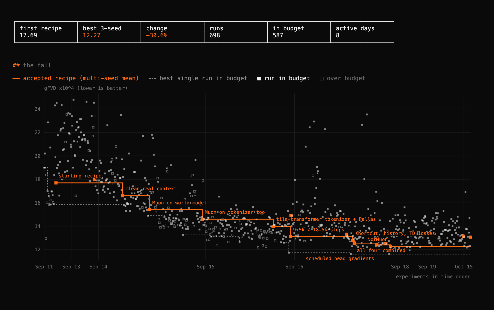

<p align="center">
  <picture>
    <source media="(prefers-color-scheme: dark)" srcset="docs/assets/logo-dark.png">
    
  </picture>
</p>

<h3 align="center">Play a world model trained in 10 minutes for 10 cents.</h3>

<p align="center">
  <a href="https://maharishiva.github.io/tinywmcraft/"><b>Play it in your browser</b></a> ·
  <a href="https://maharishiva.github.io/tinywmcraft/#leaderboard">Leaderboard</a> ·
  <a href="program.md">How to beat it</a> ·
  <a href="https://huggingface.co/maharishiva/tinywmcraft">Checkpoints</a>
</p>

<p align="center">
  
</p>

<p align="center"><sub>One held-out episode. Eight real frames prime the model, then it imagines 32 frames from the recorded keys alone.
Real game left, world model right, pressed key below.</sub></p>

tinywmcraft learns [Craftax-Classic](https://github.com/MichaelTMatthews/Craftax), a 2D Minecraft, from **500k transitions** of pixels and actions,
collected by a frozen pretrained agent playing greedily at mid-game skill.
Given a few real frames and an action, it generates the next frame, the reward and whether the episode ended.
No game state, tile labels or pretrained features enter the model.

It is also an open speedrun: lower the generation error (gFVD) in one 10-minute A100 run, with any model and any sampler.

**13.9M parameters** (5.2M tokenizer, 8.6M world model). **One cold run with its eval is about 12 minutes of A100, about $0.10 on Colab.**

<p align="center">
  
</p>

| file | what it is |
|---|---|
| [train.py](train.py) | tokenizer and flow-matching world model with reward and termination heads |
| [kernels.py](kernels.py) | fused Pallas kernels for attention, norms and activations on NVIDIA GPUs |
| [eval.py](eval.py) | the frozen benchmark |
| [play_wm.py](play_wm.py) | play inside a trained model with your keyboard |
| [microwm.py](microwm.py) | the whole model on one page: under 250 lines, no custom kernels |
| [program.md](program.md) | rules, the model interface, and how to submit a record |

## Records

| # | date | change | gFVD ↓ | AF ↑ | reward precision ↑ | max cold time | checkpoints |
|---|---|---|---:|---:|---:|---:|---|
| 1 | 2026-10-15 | hybrid tile tokenizer, Pallas kernels, Muon, reward and termination heads | 14.7 ± 1.9 | 0.929 | 0.897 | 581 s | [seeds 0, 1, 2](https://huggingface.co/maharishiva/tinywmcraft) |

gFVD is shown times 10^4. Mean ± sample SD over training seeds 0, 1 and 2, each trained cold on one Colab A100-SXM4-40GB and scored by `eval.py`.
All records with their pull requests: [leaderboard](https://maharishiva.github.io/tinywmcraft/#leaderboard). Per-seed rows: [validation/colab_20261015.md](validation/colab_20261015.md).

Every experiment of the research so far, as a dot over time, with the accepted recipe as the falling line ([interactive version](https://maharishiva.github.io/tinywmcraft/progress.html)):

<p align="center"><a href="https://maharishiva.github.io/tinywmcraft/progress.html"></a></p>

## Quickstart

Play the record. No dataset or GPU needed; a Mac CPU works:

```bash
git clone https://github.com/Maharishiva/tinywmcraft && cd tinywmcraft
uv venv --python 3.11 && source .venv/bin/activate
uv pip install -r pyproject.toml --extra play
curl -L --fail --create-dirs -o runs/record1/model.npz https://huggingface.co/maharishiva/tinywmcraft/resolve/main/record1_main_s0/model.npz
python play_wm.py --model runs/record1/model.npz
```

Train and score your own on an NVIDIA GPU:

```bash
uv pip install -r pyproject.toml --extra cuda
mkdir -p data
curl -L --fail -o data/train.npz https://huggingface.co/datasets/maharishiva/tinywmcraft_500k/resolve/main/train.npz
curl -L --fail -o data/eval.npz  https://huggingface.co/datasets/maharishiva/tinywmcraft_500k/resolve/main/eval.npz
python train.py --data data/train.npz --out runs/base/model.npz --seed 0   # about 580 s on one A100, compilation included
python eval.py  --model runs/base/model.npz --tag base --gif               # frozen benchmark, appends to ledger.jsonl
```

## Rules

- **Data:** train only on `data/train.npz`, at most 500k transitions.
- **Compute:** at most 600 s per training run on one A100 40GB, everything included, with no persistent compilation cache.
- **Evaluator:** `eval.py` stays byte-identical and its whole run takes at most 180 s on the same GPU. Any model and any sampler, as long as it generates one frame per action without seeing future actions.
- **Seeds:** report training seeds 0, 1 and 2.
- **Gates:** the mean gFVD beats the record by a noise-aware margin; AF and every reward and termination metric stay within 2% of the record.

Details, the model interface and how to submit: [program.md](program.md).

## How it works

- **Tokenizer.** A 63×63 frame becomes a 4×4×32 latent: the 81 tiles of 7×7 pixels are tokens for six transformer blocks, then a stride-2 conv and four residual conv blocks; the decoder mirrors it. Training mixes clean, half-masked and noised frames, always reconstructing the clean one.
- **World model.** A six-block, width-256 transformer alternates spatial attention over the 16 latent tokens with causal attention across 32 frames. Actions and per-frame noise levels condition adaLN-zero blocks; flow matching predicts the clean latent, and eight Euler steps generate each frame.
- **Heads.** A reward head (two-hot over 255 symlog bins) and a termination head read each frame's mean token, so the model predicts rewards and episode ends along with frames.
- **Optimizer.** Muon on every matrix and conv kernel, AdamW on embeddings, biases and norms; warmup, constant, then linear decay over the last 20% of steps.
- **Training windows.** Half are mined from recent high-loss windows, a quarter start at episode resets, the rest are uniform.
- **Kernels.** At width 256 the step is bound by memory traffic, so attention, modulated norms, gated residuals and GELU run as fused Pallas kernels on NVIDIA GPUs and fall back to XLA elsewhere.
- **In the browser.** Spatial attention stays within a frame and temporal attention is causal, so the past frames are computed once per keypress and each Euler step runs only the new frame: about 6 GFLOP per frame on WebGPU.

## Evaluation

The frozen evaluator samples 2048 windows from held-out episodes with fixed seeds, primes the model on eight real frames and generates 16 frames open-loop, one action at a time.

- **gFVD ↓:** Fréchet distance between real and generated 4-frame clips in a fixed random CNN's feature space, times 10^4. It needs no external checkpoint and is not comparable to I3D FVD. A random CNN is not a perceptual metric; what the number tracks is visible below, where the four episodes drift at different rates.
- **AF ↑:** action following, the share of windows where the true actions predict the salient pixels better than random actions under the same context and keys. An action-blind model scores 0.5.
- **Heads:** reward correlation, reward event recall and precision, and done AUC, both on real frames and on the model's own imagined rollout.

<p align="center">
  
</p>

<p align="center"><sub>Four held-out episodes, primed with 5 / 15 / 30 / 90 real frames, then 32 imagined frames.
Ground truth left, world model right, same actions.</sub></p>

## References

[Craftax](https://arxiv.org/abs/2402.16801) ·
[Flow Matching](https://arxiv.org/abs/2210.02747) ·
[Diffusion Forcing](https://arxiv.org/abs/2407.01392) ·
[DiT](https://arxiv.org/abs/2212.09748) ·
[Dreamer 4](https://arxiv.org/abs/2509.24527) ·
[Muon](https://kellerjordan.github.io/posts/muon/) ·
[FVD](https://arxiv.org/abs/1812.01717)

MIT license. Game sprites in the browser player are from Craftax (MIT).
