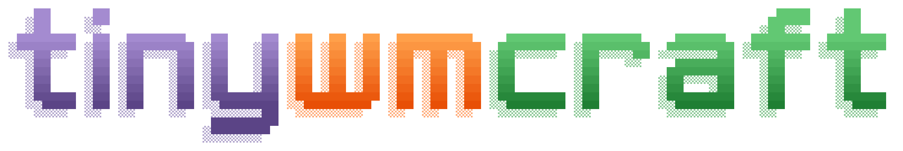
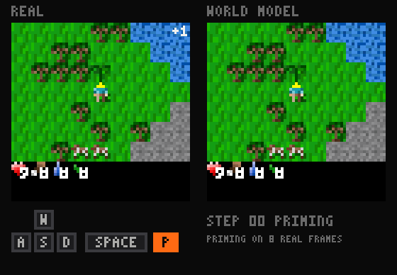
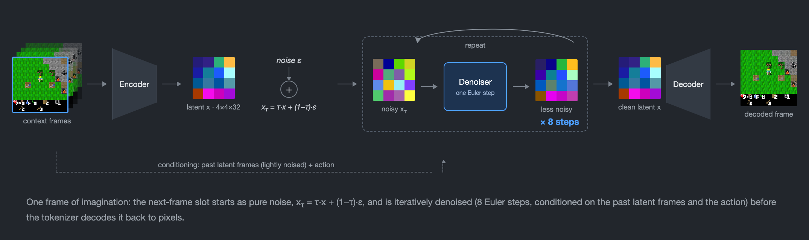
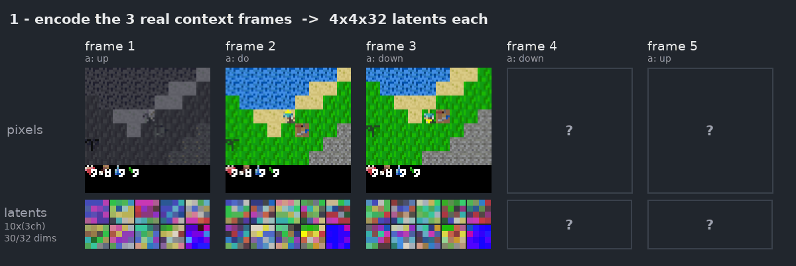
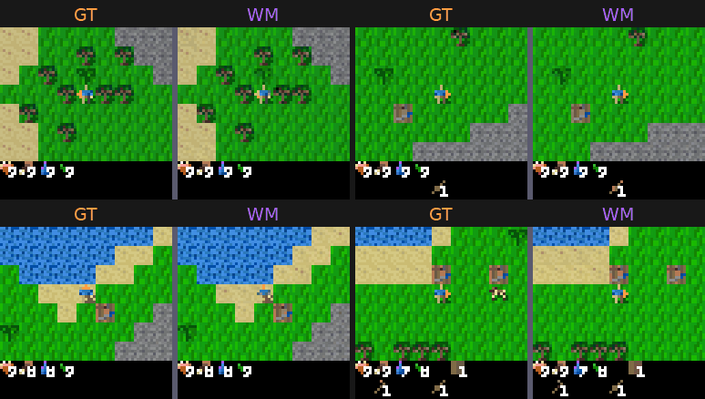

<p align="center">
  <picture>
    <source media="(prefers-color-scheme: dark)" srcset="assets/logo-dark.png">
    
  </picture>
</p>

<p align="center">
  A tiny pixel world model for Craftax, trained from scratch in <b>10 minutes on one A100</b>, for about <b>10 cents</b>.
</p>

<p align="center">
  
</p>

<p align="center"><sub>One held-out episode. Eight real frames prime the model, then it imagines 32 frames from the recorded keys alone.
Real game left, world model right, pressed key below.</sub></p>

tinywmcraft learns [Craftax-Classic](https://github.com/MichaelTMatthews/Craftax) from **500k transitions** of pixels and actions,
collected by a frozen pretrained agent playing greedily at mid-game skill.
Given a few real frames and an action, it generates the next frame, the reward and whether the episode ended.
No game state, tile labels or pretrained features enter the model.
The goal is a speedrun: lower the generation error (gFVD) under a fixed data, compute and evaluation budget.

**13.9M parameters** (5.2M tokenizer, 8.6M world model). **One cold run with its eval is about 12 minutes of A100, about $0.10 on Colab.**

| file | what it is |
|---|---|
| [train.py](train.py) | tokenizer and flow-matching world model with reward and termination heads |
| [kernels.py](kernels.py) | fused Pallas kernels for attention, norms and activations on NVIDIA GPUs |
| [eval.py](eval.py) | the frozen benchmark |
| [play_wm.py](play_wm.py) | play inside a trained model with your keyboard |

## Records

| # | date | change | mean gFVD ↓ | AF ↑ | reward precision ↑ | max cold time | checkpoints |
|---|---|---|---:|---:|---:|---:|---|
| 1 | 2026-10-15 | hybrid tile tokenizer, Pallas kernels, Muon, reward and termination heads | 0.00147 ± 0.00019 | 0.929 | 0.897 | 581 s | [seeds 0, 1, 2](https://huggingface.co/maharishiva/nanowmcraft) |

Mean ± sample SD over training seeds 0, 1 and 2, each trained cold on one Colab A100-SXM4-40GB and scored by `eval.py`.
Per-seed rows and full metric vectors: [validation/colab_20261015.md](validation/colab_20261015.md).

Every experiment of the research so far, as a dot over time, with the accepted recipe as the falling line ([interactive version](https://maharishiva.github.io/tinywmcraft/progress.html)):

<p align="center"><a href="https://maharishiva.github.io/tinywmcraft/progress.html"></a></p>

## Quickstart

```bash
uv venv --python 3.11
uv pip install -r pyproject.toml --extra play        # add --extra cuda on an NVIDIA GPU
source .venv/bin/activate

mkdir -p data
curl -L --fail -o data/train.npz https://huggingface.co/datasets/maharishiva/tinywmcraft_500k/resolve/main/train.npz
curl -L --fail -o data/eval.npz  https://huggingface.co/datasets/maharishiva/tinywmcraft_500k/resolve/main/eval.npz
```

```bash
python train.py --data data/train.npz --out runs/base/model.npz --seed 0   # about 580 s on one A100, compilation included
python eval.py  --model runs/base/model.npz --tag base --gif               # frozen benchmark, 2 to 2.5 min, appends to ledger.jsonl
python play_wm.py --model runs/base/model.npz                              # keyboard play; CPU works on a Mac
```

To play without training, download a record checkpoint:

```bash
curl -L --fail --create-dirs -o runs/record1/model.npz https://huggingface.co/maharishiva/nanowmcraft/resolve/main/record1_main_s0/model.npz
python play_wm.py --model runs/record1/model.npz
```

## Rules

- **Data:** train only on `data/train.npz`, at most 500k transitions.
- **Compute:** at most 600 s per training run on one A100 40GB, tokenizer, data loading and compilation included, with no persistent compilation cache. Eval time does not count. The maintainer reruns on a Colab A100-SXM4-40GB; cold training time there matched an A100 on another cloud within 1%.
- **Evaluator:** `eval.py` stays byte-identical: 2048 windows, 8 real context frames, 16 generated frames, 8 Euler steps.
- **Autoregressive:** generate frame by frame; denoising several future frames jointly is not a valid entry.
- **Seeds:** report training seeds 0, 1 and 2, every run, and the full metric vector.
- **Gates:** a new record lowers the mean gFVD by more than 0.0001, and its mean AF and every reward and termination metric stay within 2% of the current record's means, both measured in the same maintainer rerun on the same seeds and machine.

One run is noisy: the same recipe and seed differ by up to 0.0002 gFVD between fresh compiles. Compare three-seed means, never single runs.

## Submitting

1. Open a pull request with your changes to `train.py` or `kernels.py`.
2. Include the three `ledger.jsonl` rows from `eval.py` and the cold training time of each seed.
3. Upload the three `model.npz` files to Hugging Face and link them, so anyone can play and score them.
4. A maintainer retrains the three seeds from the pull request next to the current record. The record stands if that rerun beats the current mean and passes every gate.

## How it works

- **Tokenizer.** A 63×63 frame becomes a 4×4×32 latent: the 81 tiles of 7×7 pixels are tokens for six transformer blocks, then a stride-2 conv and four residual conv blocks; the decoder mirrors it. Training mixes clean, half-masked and noised frames, always reconstructing the clean one.
- **World model.** A six-block, width-256 transformer alternates spatial attention over the 16 latent tokens with causal attention across 32 frames. Actions and per-frame noise levels condition adaLN-zero blocks; flow matching predicts the clean latent, and eight Euler steps generate each frame.
- **Heads.** A reward head (two-hot over 255 symlog bins) and a termination head read each frame's mean token, so `imagine` returns frames, rewards and episode ends.
- **Optimizer.** Muon on every matrix and conv kernel, AdamW on embeddings, biases and norms; warmup, constant, then linear decay over the last 20% of steps.
- **Training windows.** Half are mined from recent high-loss windows, a quarter start at episode resets, the rest are uniform.
- **Kernels.** At width 256 the step is bound by memory traffic, so attention, modulated norms, gated residuals and GELU run as fused Pallas kernels on NVIDIA GPUs and fall back to XLA elsewhere.





## Evaluation

The frozen evaluator samples 2048 windows from held-out episodes with fixed seeds, primes the model on eight real frames and generates 16 frames open-loop.
It takes 143 s on a Colab A100 and 94 s on the research VM's A100 for the same windows.

- **gFVD ↓:** Fréchet distance between real and generated 4-frame clips in a fixed random CNN's feature space. It needs no external checkpoint and is not comparable to I3D FVD. A random CNN is not a perceptual metric; what the number tracks is visible below, where the four episodes drift at different rates.
- **AF ↑:** action following, the share of windows where the true actions predict the salient pixels better than random actions under the same context and noise. An action-blind model scores 0.5.
- **Heads:** reward correlation, reward event recall and precision, and done AUC, both on real frames and on the model's own imagined rollout.

<p align="center">
  
</p>

<p align="center"><sub>Four held-out episodes, primed with 5 / 15 / 30 / 90 real frames, then 32 imagined frames.
Ground truth left, world model right, same actions.</sub></p>

## References

[Craftax](https://arxiv.org/abs/2402.16801) ·
[Flow Matching](https://arxiv.org/abs/2210.02747) ·
[Diffusion Forcing](https://arxiv.org/abs/2407.01392) ·
[DiT](https://arxiv.org/abs/2212.09748) ·
[Dreamer 4](https://arxiv.org/abs/2509.24527) ·
[Muon](https://kellerjordan.github.io/posts/muon/) ·
[FVD](https://arxiv.org/abs/1812.01717)

MIT license.
